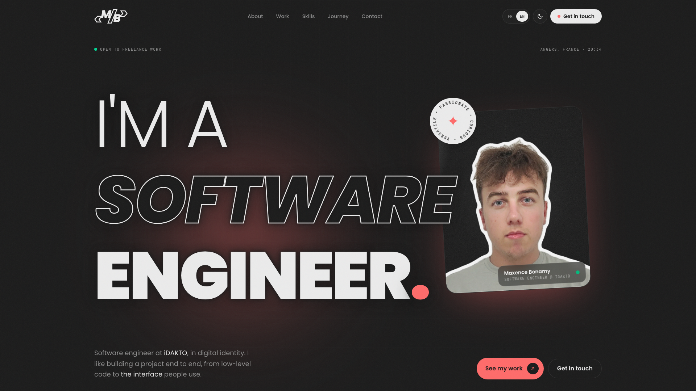

# Portfolio v5

Personal portfolio of Maxence Bonamy, software engineer.

Bilingual website presenting the author, his projects, skills and journey. French at the root (`/projects`) and English under `/en` (`/en/projects`). All the content lives in JSON files, so it can be edited without touching the components. This is the fifth version of the portfolio, hosted at [maxencebonamy.fr](https://maxencebonamy.fr).



## Table of contents

- [Portfolio v5](#portfolio-v5)
	- [Table of contents](#table-of-contents)
	- [How it works](#how-it-works)
	- [Tech stack](#tech-stack)
	- [Repository structure](#repository-structure)
	- [Prerequisites](#prerequisites)
	- [Installation](#installation)
	- [Running locally](#running-locally)
	- [Useful scripts](#useful-scripts)
	- [Tests and quality](#tests-and-quality)
	- [Deployment](#deployment)
	- [License](#license)

## How it works

1. **Content**: texts, projects, skills and journey are stored in `src/data/*.json`. Every text has both languages: `{ "fr": "...", "en": "..." }`. Each file points to its JSON Schema with `$schema`, so the editor autocompletes and flags mistakes.
2. **Validation**: Zod schemas in `src/schemas` validate the data at build time, not in the browser, and generate the JSON Schemas.
3. **Routing**: the language is an optional `{-$lang}` route segment. Nothing redirects by language: a banner offers the browser language when it differs, and the choice is saved.
4. **Prerender**: the build follows the links from the home page and renders every page in both languages as static HTML, then the browser hydrates it.
5. **SEO**: each page renders its title, meta tags and JSON-LD with `PageHead`. The build writes `404.html`, `sitemap.xml` (with `hreflang` alternates) and `robots.txt`.
6. **Media**: project videos are encoded from source files with FFmpeg. The outlined portrait, the social card and the Apple touch icon are generated with sharp.

## Tech stack

| Layer | Technologies |
| --- | --- |
| Framework | TanStack Start, TanStack Router, React 19, Vite |
| Styles | Tailwind CSS 4, `clsx`, `tailwind-merge` |
| Animation | Motion, Lenis |
| Content | JSON files, Zod 4 (validation and JSON Schema generation) |
| Media | sharp (images), FFmpeg (videos) |
| Tooling | pnpm, TypeScript, ESLint, tsx |
| Deployment | Vercel, GitHub Actions |

## Repository structure

```
.
├── .github/workflows/   CI
├── media/               Hero screenshot and source media (videos are ignored, see below)
├── public/              Static files (videos, photo, resumes, icons)
├── scripts/             Sitemap, schemas, media encoding
└── src/
    ├── components/      atoms, molecules, motion, organisms, sections, templates, pages
    ├── config/          Constants (sections, logo, storage keys)
    ├── content/         Typed access to the data files
    ├── data/            Editable content (JSON) and generated JSON Schemas
    ├── hooks/           React hooks
    ├── lib/             Helpers (i18n, theme, scroll, boot script)
    ├── providers/       Language and smooth scroll
    ├── routes/          One file per route and the HTML document
    ├── schemas/         Zod schemas of the data files
    ├── seo/             Page metadata and structured data
    ├── client.tsx       Hydrates the prerendered HTML
    └── router.tsx
```

Code uses tabs, kebab-case file names, `#/` absolute imports (pointing to `src/`), named exports and `const` arrow functions. Everything is in English except the content of `src/data`. `src/routeTree.gen.ts` is generated from `src/routes`: do not edit it.

Pages are rendered at build time and in the browser, and both renders must match: do not read `window`, `document`, `localStorage` or `navigator` while rendering. The saved theme is applied before the first paint by `src/lib/boot-script.ts`.

## Prerequisites

- [Node.js](https://nodejs.org/) 22 or later (the CI uses the version in `.nvmrc`)
- [pnpm](https://pnpm.io/) (version declared in `packageManager`)
- [FFmpeg](https://ffmpeg.org/) in your `PATH`, only to re-encode the project videos
- [GitHub CLI](https://cli.github.com/), logged in, only to sync the source videos

## Installation

```bash
git clone git@github.com:maxencebonamy/portfolio.git
cd portfolio
pnpm install
```

The project reads no environment variable.

## Running locally

```bash
pnpm run dev
```

The site is then available at <http://localhost:5173>. To serve the production build:

```bash
pnpm run build
pnpm run preview
```

The source videos are too heavy for the git history: they are stored as assets of the `media` GitHub release. To get them in `media/originals/`:

```bash
pnpm run media:pull
```

To add a project, put the source video in `media/originals/`, add an entry to `src/data/projects.json` (its `slug` is the URL, `/projects/<slug>`) with its `video` field (`source`, `previewStart` and `posterAt`, in seconds, plus optional `crf` and `maxrate` in Mbit/s for noisy footage), then encode it:

```bash
pnpm run media:videos <slug>
```

Then run `pnpm run media:push` to upload the new or changed source videos to the release.

The order of the file is the display order, `featured: true` shows the project on the home page, and `ongoing: true` shows "In progress" instead of the year. If you rename the slug of a project already online, add a redirect in `vercel.json`.

## Useful scripts

| Command | Effect |
| --- | --- |
| `pnpm run dev` | Start the development server |
| `pnpm run build` | Check the data, prerender every page in `dist/client`, type-check and write the sitemap |
| `pnpm run preview` | Serve the production build |
| `pnpm run check` | Type-check, lint and validate the data |
| `pnpm run typecheck` | Type-check with `tsc -b` |
| `pnpm run lint` | Lint the repository |
| `pnpm run lint:fix` | Lint and fix what can be fixed automatically |
| `pnpm run schemas` | Regenerate the JSON Schemas after a change in `src/schemas` |
| `pnpm run sitemap` | Generate the sitemap |
| `pnpm run media:videos` | Encode the project videos (pass a `<slug>` to encode only one) |
| `pnpm run media:images` | Generate the outlined portrait, the social card and the Apple touch icon |
| `pnpm run media:pull` | Download the source videos from the `media` release |
| `pnpm run media:push` | Upload the new or changed source videos to the `media` release |

## Tests and quality

The repository has no test suite. Quality is enforced by type-checking, ESLint and data validation:

```bash
pnpm run check
```

## Deployment

The CI (`.github/workflows/ci.yml`) runs on every push to `main` and every pull request: frozen-lockfile install, `pnpm run check`, then `pnpm run build`.

[`vercel.json`](vercel.json) configures Vercel: build with `pnpm run build`, output in `dist/client`, clean URLs, permanent redirects from the old French URLs and from `/fr`, cache and security headers. If the domain changes, update `url` in `src/data/site.json` and run `pnpm run media:images`.

## License

This project is licensed under the [MIT License](LICENSE). The personal content (texts, photo, videos, resumes, logo) is not covered by it: see [LICENSE-CONTENT.md](LICENSE-CONTENT.md).
